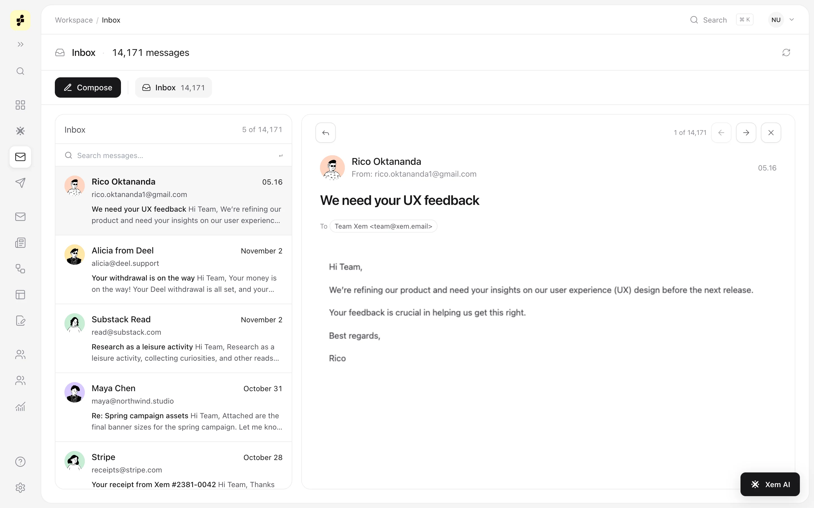
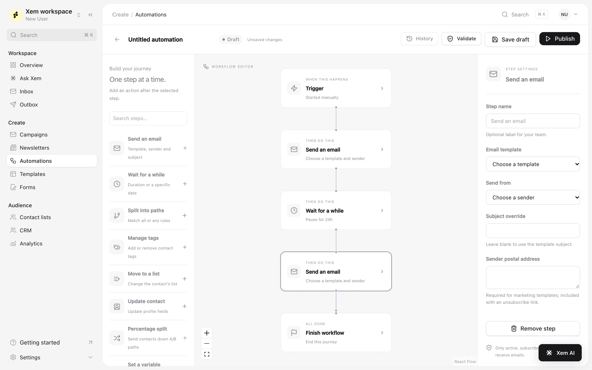
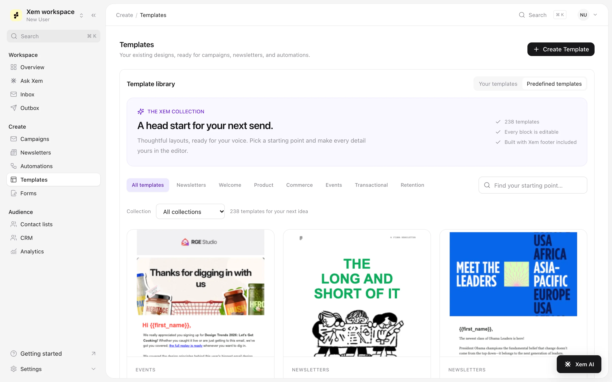
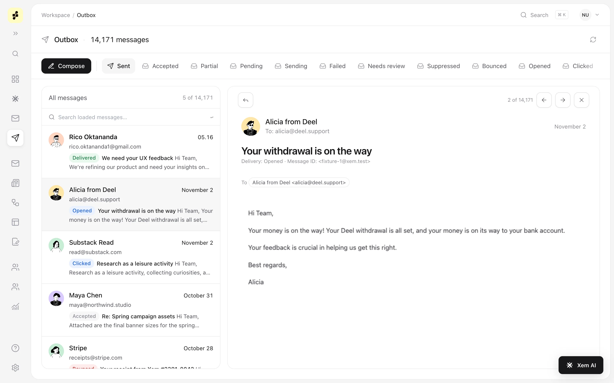
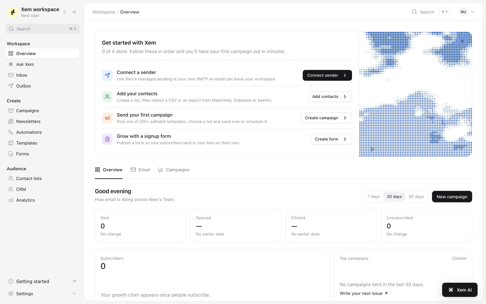
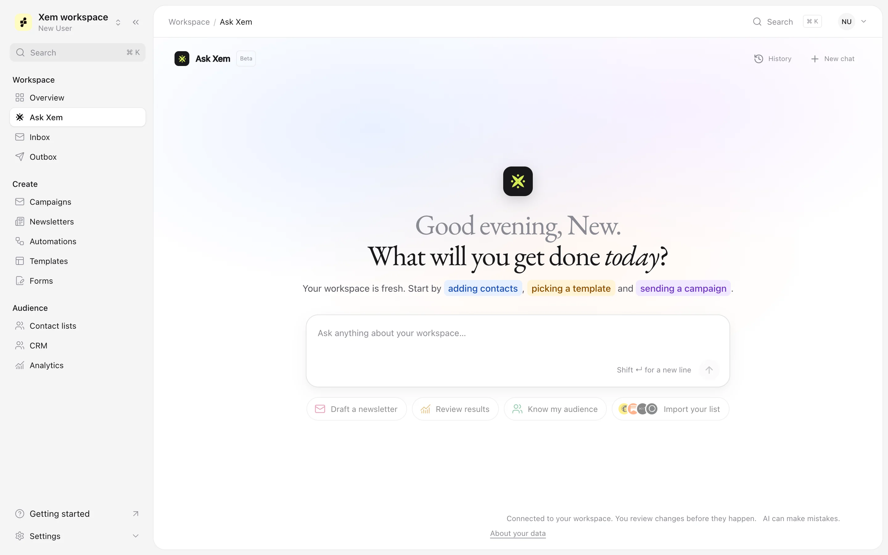
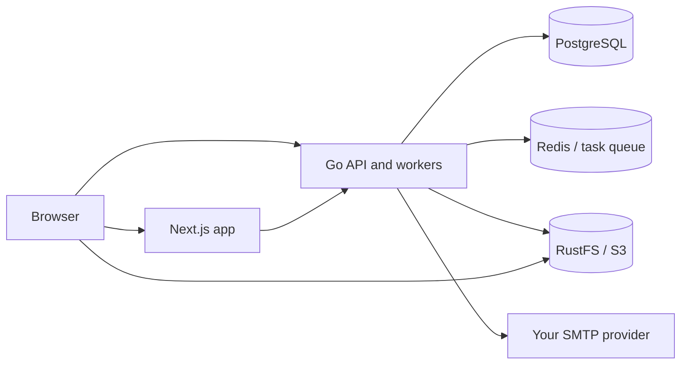

<p align="center">
  
</p>

<h1 align="center">Xem</h1>

<p align="center">
  <b>A self-hosted alternative to Mailchimp.</b><br />
  Campaigns, newsletters, visual automations, signup forms, a contact CRM and a shared inbox, sending through your own Amazon SES or SMTP.
</p>

<p align="center">
  <a href="https://app.xem.email/auth/register">Try Xem Cloud free</a> ·
  <a href="#deploy">Self-host</a> ·
  <a href="https://xem.email/compare">Compare</a> ·
  <a href="https://docs.xem.email">Docs</a> ·
  <a href="https://github.com/mailxem/mail/issues">Issues</a>
</p>

<p align="center">
  <a href="LICENSE"></a>
  
  
  
  <a href="https://hakopod.com"><picture><source media="(prefers-color-scheme: dark)" srcset=".github/assets/hakopod-horizontal-paper.svg"></picture></a>
</p>

## Screenshots

<table>
  <tr>
    <td align="center"><br>Inbox</td>
    <td align="center"><br>Automations</td>
    <td align="center"><br>Templates</td>
  </tr>
  <tr>
    <td align="center"><br>Outbox</td>
    <td align="center"><br>Overview</td>
    <td align="center"><br>Ask Xem</td>
  </tr>
</table>

## Features

### Apps

- **Campaigns and newsletters**: send once or on a schedule, with a public archive and RSS for each newsletter.
- **Automations**: a visual builder with emails, waits, splits, percentage tests, tags, list moves, contact updates and webhooks.
- **Templates**: 179 editable starting points built from native editor blocks, plus AI drafting if you turn it on.
- **Audience**: lists, tags, segments, signup forms and a small CRM with lead stages.
- **Inbox**: read and reply to mail from IMAP, Gmail or Cloudflare mailboxes alongside your campaigns.
- **Analytics**: delivery, opens, clicks and audience growth, with honest notes on what open rates can and can't tell you.
- **Ask Xem and MCP**: an in-app assistant that shows each change for approval, and an MCP server with 44 tools for Claude and other agents.

### Technical

- **Sending**: Amazon SES or any SMTP server. One-click unsubscribe headers (RFC 8058), bounce and complaint processing into a suppression list, and guided DKIM setup. Xem doesn't own sending IPs; your reputation stays with your provider.
- **Moving in**: reads Mailchimp, Substack, beehiiv, Kit and Ghost exports directly and keeps unsubscribed people unsubscribed. Any CSV with an email column works too.
- **Stack**: Go API and workers, Next.js app, PostgreSQL, Redis and S3-compatible storage (RustFS by default).
- **APIs**: REST API, webhooks, and SDKs for [TypeScript](sdk) and [Go](sdk-go).
- **Hosting**: Docker Swarm on any Linux server, or [Xem Cloud](https://xem.email/pricing).

## Cost

Running Xem yourself is free; you pay your server and your email provider.

- **Sending through Amazon SES** costs about $0.10 per 1,000 emails. A weekly newsletter to 10,000 people is roughly $4 a month in sending. New SES accounts start in a sandbox, so ask AWS for production access first.
- **Any other SMTP provider** works at whatever it charges.
- **Xem Cloud** is priced per email sent, not per contact: 3,000 a month free, then from $9 for 20,000. Every plan has every feature. See [pricing](https://xem.email/pricing) and [how that compares](https://xem.email/compare).

Prices change, so check [Amazon SES pricing](https://aws.amazon.com/ses/pricing/) before you plan around it.

## Deploy

### One command

On a Linux host with **Docker Engine, Git, Python 3 and OpenSSL**, run:

```bash
curl -fsSL https://raw.githubusercontent.com/mailxem/mail/undefined/scripts/install.sh | bash
```

The wizard asks for the app, API and storage addresses. It builds the app and backend from the same repository revision, generates credentials, initializes Swarm when needed, and starts **Next.js + Go + PostgreSQL + Redis + RustFS**. No cloud storage account is required.

**Basic runtime target: 2 CPU cores, 2 GB RAM and 20 GB free disk** for a small installation. Source builds can need more memory or swap while building the Next.js app. See the [requirements](devops/swarm/README.md#requirements) before installing.

Use a host IP or DNS name reachable from both browsers and containers. The default ports are **3000** (app), **9001** (API) and **9000** (object storage). HTTP is intended for a trusted local network; configure HTTPS before exposing the installation publicly.

Open the printed `/auth/register` URL, create your account, and connect your own SMTP provider. Managed SES sending, hosted billing, Google OAuth and the AI assistant need extra configuration and aren't provisioned by this starter.

Prefer to read the script first?

```bash
curl -fsSLo install-xem.sh https://raw.githubusercontent.com/mailxem/mail/undefined/scripts/install.sh
less install-xem.sh
bash install-xem.sh
```

See the **[Swarm guide](devops/swarm/README.md)** for unattended setup, HTTPS, updates, backups, troubleshooting and removal. This is a single-node starter, not a high-availability deployment.

### Docker Compose

No Swarm and no wizard. On any host with **Docker Engine, the Compose plugin, Git and OpenSSL**:

```bash
git clone https://github.com/mailxem/mail.git xem && cd xem
bash scripts/compose-env.sh 192.168.1.10
docker compose up -d
```

Replace `192.168.1.10` with your server's LAN IP or DNS name, not `localhost`: the API container reaches object storage through the same address your browser uses. The script writes `.env` from [`.env.example`](.env.example) with generated database, auth and storage credentials and an RSA key. Keep `.env` and back it up. The default ports are 3000 (app), 9001 (API) and 9000 (object storage); change them in `.env` if they're taken.

The first `up` builds the app and backend from your checkout, which takes several minutes. It then starts the same five services as the Swarm path, with healthchecks, `restart: unless-stopped` and data in the `xem_postgres`, `xem_redis` and `xem_storage` volumes. Open `http://<your address>:3000/auth/register`, create your account and connect your own SMTP provider.

To update, `git pull` and run `docker compose up -d --build`. Back up first: the API runs database migrations at startup. `docker compose down` keeps your data; `docker compose down -v` deletes it. For HTTPS, put the three ports behind a TLS proxy and set the `https://` origins in `.env` before rebuilding; the [Swarm guide](devops/swarm/README.md#https-and-public-deployment) covers what the proxy needs.

### Deploy with an AI agent

Paste this into an AI agent that has terminal access to your server (Claude Code, Codex, Cursor and similar):

```text
Install Xem for me on this Linux server from https://github.com/mailxem/mail.

1. Read README.md and devops/swarm/README.md first.
2. Check that Docker Engine, Git, Python 3 and OpenSSL are installed, and that the
   server has at least 2 CPU cores, 2 GB RAM and 20 GB free disk. Tell me what's
   missing instead of installing system packages without asking.
3. Ask me for the address people will use to reach the app (an IP or DNS name).
4. Download scripts/install.sh to install-xem.sh and show me a short summary of
   what it does before running it.
5. Copy devops/swarm/config.example.json to config.json, replace its example IP
   with my address (keep ports 3000, 9001 and 9000 unless I say otherwise), then run:
   bash install-xem.sh --config ./config.json --state "$HOME/.local/share/xem"
6. Never print, commit or paste the generated credentials. They stay in the state
   directory; never delete that directory.
7. When it finishes, give me the /auth/register URL and remind me to connect an
   SMTP provider and set up SPF, DKIM and DMARC before sending.
```

### Choose a host

<p>
  <a href="devops/hosting/README.md#vultr"></a>
  <a href="devops/hosting/README.md#hetzner"></a>
  <a href="devops/hosting/README.md#digitalocean"></a>
  <a href="devops/swarm/README.md"></a>
</p>

These open setup guides; they don't provision a server for you. **Check email ports before choosing a host:** DigitalOcean blocks outbound SMTP ports 25, 465 and 587 by default, and Hetzner allows 587 but blocks 25 and 465. See the [provider comparison](devops/hosting/README.md).

### Hakopod

The Xem hosted service runs on [Hakopod](https://hakopod.com). To deploy Xem on your own Hakopod installation, use the [Hakopod configuration and deployment guide](devops/hakopod/README.md).

An opt-in custom-domain Xem inbox for operators using managed Amazon SES sending is under development; see the [managed receiving operations guide](server/docs/managed-receiving.md). Repository support and local validation don't mean the hosted service or an AWS deployment is available.

## How the pieces fit



## Clone and develop

```bash
git clone https://github.com/mailxem/mail.git
cd mail
make help

# Run the same Swarm installer from the checkout:
python3 devops/swarm/install.py
```

For frontend development, point the app at a running backend and follow [client setup](docs/client/setup.mdx). Backend configuration and API documentation live in [`server/`](server) and [`docs/`](docs). Components keep their own dependency files; component CI and releases live together in `.github/workflows/`. A single PR can change both sides of an API.

| Component | Source |
| --- | --- |
| Go API and workers | [server/](server) |
| Next.js application | [client/](client) |
| Deployment infrastructure | [devops/](devops) |
| MCP integration | [mcp/](mcp) |
| Payments | [payments.go/](payments.go) |
| TypeScript SDK | [sdk/](sdk) |
| Go SDK | [sdk-go/](sdk-go) |
| Marketing website | [website/](website) |

This is a **monorepo**: all eight components above are normal directories. No submodule initialization or second repository checkout is required. The starter deploys the app, backend, and their data services.

### CI and releases

- Frontend changes run TypeScript, Jest, and Next.js build checks.
- Backend changes run Go vet, race tests, builds, and the relevant PostgreSQL/SMTP integration checks.
- Changes to either side run the full Docker Swarm smoke test.
- Default-branch changes publish the affected component's amd64/arm64 images independently, then assemble the combined image and create a component-scoped release.
- Published backend, frontend, MCP, and payments images can be deployed automatically to Hakopod using the [release deployment workflow](docs/hakopod-deployments.md).
- Website, infrastructure, MCP, payments, and Go SDK workflows also run from the root, with checks scoped to their component paths.
- Images keep `theboringhumane/xemapp` and `theboringhumane/xemgo`; Git tags use `frontend-v*` and `backend-v*` to avoid collisions.

See the [migration and CI guide](migration/README.md) for source provenance, configuration, and the cutover from the original repositories.

## Contribute

Working on inboxes or provider integrations? See the [connected-mail setup and implementation notes](docs/connected-mail.md) for Gmail, Workspace, IMAP, and Cloudflare, including current limitations and release checks. The customer-owned inbound Worker has a separate [Cloudflare mailbox setup guide](devops/cloudflare-mailbox/README.md). The [commercial roadmap](docs/connected-mail-commercial.md) describes planned hosted and self-hosted offers; existing free features remain available.

Report bugs with reproduction steps, open a focused PR, or improve the docs. Keep credentials and local `.env` files out of commits. Make component changes directly in this repository and include related frontend/backend updates in the same PR.

Xem was previously called Posthoot. Its code is [GPL-3.0 licensed](LICENSE). Bundled third-party services retain their own licenses, including RustFS's Apache-2.0 license.
